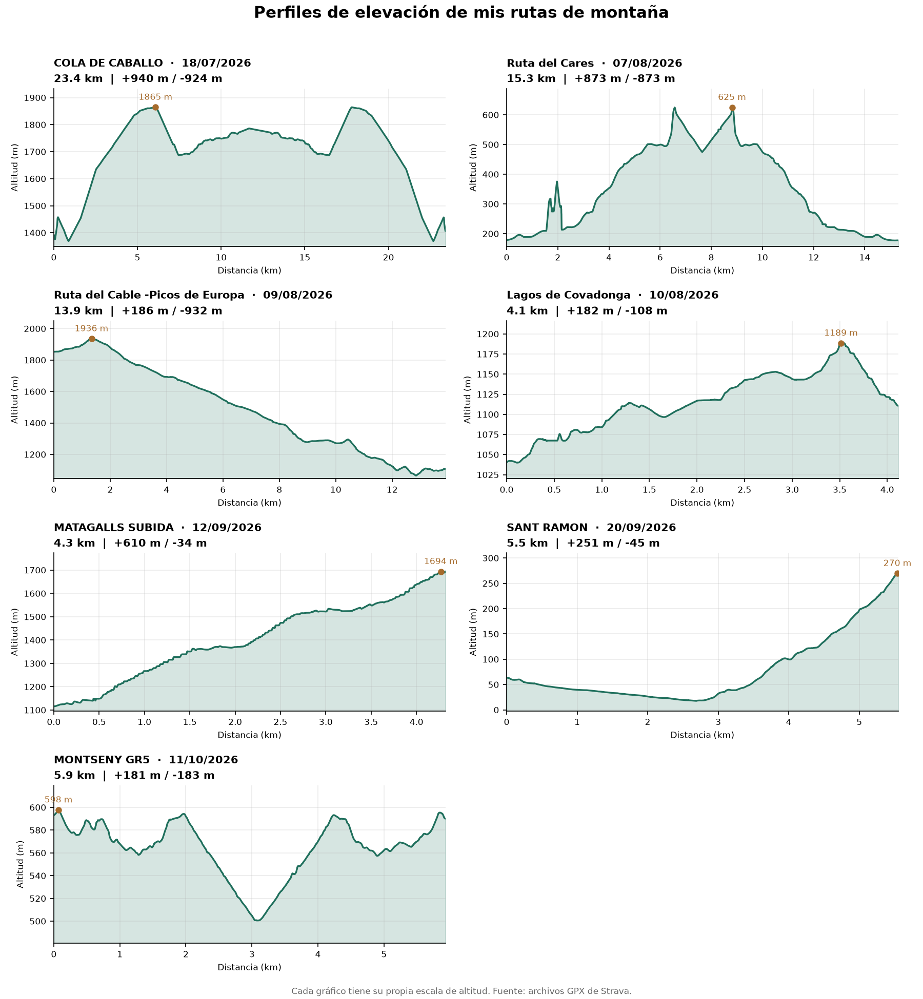

# Análisis de mis rutas de montaña



Análisis de datos de mis excursiones a partir de archivos GPX de Strava:
distancia, desnivel, tiempos, velocidad, pulsaciones y perfiles de elevación.

**Tecnologías:** Python, pandas, matplotlib.

## Estructura

```
rutas_montana/
├── data/                      # tus archivos .gpx (NO se suben a GitHub)
├── output/                    # resultados locales y resumen público
├── 01_cargar_gpx.py           # lee los GPX y calcula estadísticas
├── 02_perfiles_elevacion.py   # dibuja los perfiles de elevación
├── index.html                 # portfolio web del proyecto
├── requirements.txt           # librerías necesarias
└── README.md
```

El archivo `output/resumen.json` se genera al ejecutar el primer script y se usa para mostrar las tarjetas de rutas en `index.html`.

## Cómo ejecutarlo

1. Instala Python 3.10 o superior (https://www.python.org/downloads/).
   En Windows, marca la casilla "Add Python to PATH" durante la instalación.
2. Abre la carpeta del proyecto en VS Code y abre una terminal (Terminal > Nueva terminal).
3. Crea y activa un entorno virtual:
   - Windows: `python -m venv .venv` y luego `.venv\Scripts\activate`
   - Mac/Linux: `python3 -m venv .venv` y luego `source .venv/bin/activate`
4. Instala las librerías: `pip install -r requirements.txt`
5. Ejecuta los scripts en orden:
   - `python 01_cargar_gpx.py`
   - `python 02_perfiles_elevacion.py`

Los resultados aparecen en la carpeta `output/`.

## Portfolio web

`index.html` presenta el proyecto, las estadísticas de cada ruta y el gráfico de elevación en una página adaptable a móviles. `01_cargar_gpx.py` genera `output/resumen.json`, el resumen público que utiliza la página. El JSON no contiene coordenadas ni datos de pulsaciones.

### Añadir una ruta al portfolio

1. Guarda el archivo `.gpx` nuevo en `data/`.
2. Activa el entorno virtual e instala dependencias si hace falta: `pip install -r requirements.txt`.
3. Ejecuta `python 01_cargar_gpx.py` y después `python 02_perfiles_elevacion.py`.
4. Comprueba `index.html` en un servidor web local: ejecuta `python -m http.server 8000` desde la carpeta del proyecto y abre `http://localhost:8000`. El resumen y el gráfico se actualizan al ejecutar los scripts.
5. En GitHub Desktop, revisa los archivos, confirma solo los cambios seguros de `output/resumen.json` y `output/perfiles_elevacion.png`, y haz **Push origin**. No subas `data/`, `output/puntos.csv` ni `output/resumen.csv`.

Los archivos GPX de `data/` y los CSV `output/puntos.csv` y `output/resumen.csv` contienen información detallada y permanecen locales, excluidos de Git mediante `.gitignore`. El resumen público incluye los nombres y fechas de las rutas y métricas de distancia y altitud; el gráfico también muestra nombres y fechas.

### Publicar con GitHub Pages

Después de publicar el repositorio, abre **Settings > Pages**. En **Build and deployment**, selecciona **Deploy from a branch**, la rama `main` y la carpeta `/(root)`. GitHub Pages publicará `index.html` y mostrará la URL del sitio en esa misma sección.

## Metodología (resumen)

- **Distancia:** fórmula de Haversine entre puntos consecutivos.
- **Desnivel:** acumulado con un umbral de 3 m para descartar el ruido del altímetro del GPS.
- **Tiempo en movimiento:** solo intervalos a más de 1 km/h.
- **Pulsaciones:** se ignoran los valores a 0 (significan "sin dato").

## Limitaciones

- La altitud del GPS tiene error de varios metros; el desnivel es una estimación.
- Una de las rutas no incluye pulsaciones.
